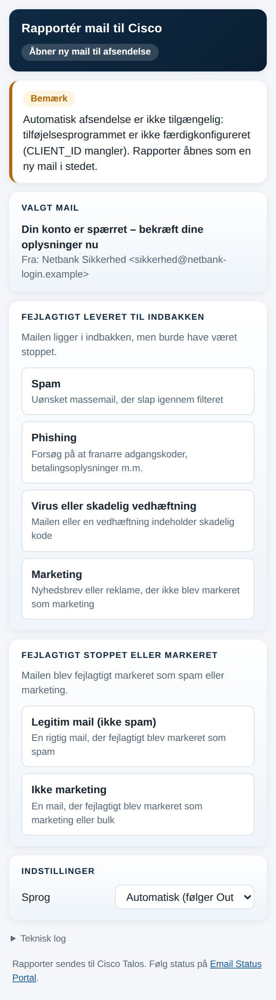

# Troubleshooting

## Start with the log

Every pane has a collapsed **Teknisk log** at the bottom. It is the first thing to ask a user
for. The same lines go to the browser console with the prefix `[CiscoReporter]`
(Outlook desktop: right-click in the pane → *Inspect*; Outlook on the web: F12).

A healthy graph-mode report looks like this:

```text
13:26:06 INFO Start {"addin":"1.4.0","host":"Outlook","platform":"PC","version":"16.0.18…","displayLanguage":"da-DK"}
13:26:06 INFO Language: da {"source":"Outlook display language da-DK","available":["da","en","sv"]}
13:26:06 INFO Send mode: graph {"configured":"graph","fallback":true}
13:26:06 INFO Mail selected {"subject":"…","from":"…","itemId":"AAMkAGI2THVSAAA…"}
13:26:10 INFO Report started {"category":"phish","mode":"graph"}
13:26:10 INFO Initialising MSAL (NAA) {"authority":"https://login.microsoftonline.com/…"}
13:26:10 INFO Token acquired (silent) {"scopes":["Mail.Send","Mail.ReadWrite"]}
13:26:11 INFO EML fetched {"bytes":48213}
13:26:12 INFO Report sent via Graph {"to":"phish@access.ironport.com","category":"phish"}
13:26:12 INFO Message moved {"to":"junkemail","mailbox":"me"}
```

The same report for a mail in a shared mailbox adds the lookup and a second token:

```text
13:31:02 INFO Mail selected {"subject":"…","from":"…","itemId":"AAMkADk3ZWUyAAA…"}
13:31:02 INFO Item is in a shared mailbox or folder {"owner":"support@contoso.com","targetMailbox":"support@contoso.com","delegatePermissions":63,"user":"anna@contoso.com"}
13:31:05 INFO Report started {"category":"spam","mode":"graph","language":"da","sharedMailbox":"support@contoso.com"}
13:31:05 INFO Token acquired (silent) {"scopes":["Mail.Send"]}
13:31:06 INFO EML fetched {"bytes":51877}
13:31:07 INFO Report sent via Graph {"to":"spam@access.ironport.com","category":"spam","sharedMailbox":"support@contoso.com"}
13:31:07 INFO Token acquired (silent) {"scopes":["Mail.ReadWrite.Shared"]}
13:31:08 INFO Message moved {"to":"junkemail","mailbox":"support@contoso.com"}
```

The `Send mode` line lists the reasons whenever the configured mode is not active, for example
`"reasons":["CLIENT_ID is empty in config.js"]` or `["NestedAppAuth 1.1 not supported by this client"]`,
and whether the compose fallback is allowed.

## What the fallback looks like

When graph mode cannot run, the pane keeps working but says so:



## Symptoms

| Symptom                                                                 | Cause and fix                                                                                                                                                                                                                              |
| ----------------------------------------------------------------------- | ------------------------------------------------------------------------------------------------------------------------------------------------------------------------------------------------------------------------------------------ |
| Warning *Automatic send is not available …* under the header             | Graph is the default but cannot run. The `Send mode` log line lists the reasons: `CLIENT_ID is empty` → finish step 2–3 of the deployment guide; Mailbox 1.14 / NestedAppAuth missing → update the Outlook client; `MSAL … not loaded` → `lib/msal-browser.min.js` returns 404 or is blocked by CSP. Reports still work through the fallback (new message) unless `COMPOSE_FALLBACK` is `false`. |
| Chip says *Unavailable* and all buttons are disabled                     | Graph cannot run and `COMPOSE_FALLBACK` is `false` (or the client lacks Mailbox 1.6). Fix the graph preconditions, or allow the fallback.                                                                                                      |
| Users see the new-message window although they should not                | The fallback is being used – look for the warning under the header and the `Send mode` log line. Set `COMPOSE_FALLBACK: false` if you would rather have an error than a new message.                                                        |
| `AADSTS65001` / *mangler samtykke*                                       | Admin consent not granted for `Mail.Send` (and `Mail.ReadWrite`). Grant it in the app registration, or let the user consent if the tenant allows user consent.                                                                             |
| `AADSTS50011` redirect URI mismatch                                      | The SPA redirect URI `brk-multihub://<origin>` does not match the origin serving `taskpane.html`. Compare scheme-less host (and port) exactly. A path in the redirect URI is invalid.                                                          |
| `AADSTS700016` application not found                                     | `CLIENT_ID` is wrong or the registration is in another tenant than `AUTHORITY` points to.                                                                                                                                                  |
| `BrowserAuthError: popup_window_error` / nothing happens after the click | Interactive fallback needed but pop-ups are blocked. Grant admin consent so the silent path succeeds, or allow pop-ups for the add-in origin.                                                                                                |
| *Rapporten er sendt, men mailen kunne ikke flyttes* in the log           | `Mail.ReadWrite` missing or not consented. Grant it or set `MOVE_AFTER_REPORT: false`. The report itself was delivered.                                                                                                                       |
| `ErrorSendAsDenied` / status *(Send As)* with `SEND_AS` set              | The user lacks *Send As* on the shared mailbox, or the permission has not propagated yet (up to an hour). Grant it in the Exchange admin center (mailbox → Delegation) or with `Add-RecipientPermission`. *Send on Behalf* is not sufficient.                |
| `403` on `sendMail` as soon as `SEND_AS` is set                           | The app has `Mail.Send` but not `Mail.Send.Shared`, or consent was not re-granted after adding it.                                                                                                                                         |
| SOC never receives copies                                                | `SOC_ADDRESSES` empty or misspelled; check the `Report sent via Graph` / `Opening new message` log lines, which list `soc` and `socMode`. With `"bcc"` the copy is not visible in the user's Sent Items either.                                |
| Graph `403 ErrorAccessDenied` on `sendMail`                              | `Mail.Send` not consented, or a mailbox policy blocks sending (shared mailbox without Send As, disabled mailbox). The user can still use *Send manuelt i stedet*.                                                                             |
| Graph `413` or `ErrorMessageSizeExceeded`                                | EML larger than Graph accepts inline. Lower `MAX_GRAPH_ATTACHMENT_BYTES` so the automatic fallback triggers earlier.                                                                                                                       |
| Large messages always open a new mail                                    | Expected above `MAX_GRAPH_ATTACHMENT_BYTES` (3 MB). Compose mode has no such limit; Cisco accepts up to 10 MB in total.                                                                                                                   |
| `getAsFileAsync` fails                                                   | Item is a draft or a meeting request, or Outlook cannot export it. From 1.4.0 the pane then reads the MIME content through Graph by itself (log: `getAsFileAsync failed – reading the MIME content through Graph instead`); the error only reaches the user if that fails too. |
| New mail opens without the attachment                                    | Item not saved on the server (draft) or the client could not resolve the `itemId`. Report only received messages.                                                                                                                          |
| Button *Report to Cisco* missing                                         | Deployment not propagated yet (up to 24 h); reading pane turned off (Office.js needs it); user not in the assigned group; item is not a message (appointments never show the button).                                                        |
| Button missing in a shared mailbox, present in the user's own mailbox   | A manifest older than 1.4.0 is still deployed (no `SupportsSharedFolders`); the add-in was deployed to the shared mailbox instead of to the user; or the Outlook client is older than the versions in `docs/ARCHITECTURE.md` § 7. |
| Pane says *No mail selected* on a mail in a shared mailbox               | Microsoft limitation: the shared mailbox is hidden from the address list, or the user signed in to it with the mailbox's own password. Office.js then hands the add-in no item.                                                           |
| No *Shared mailbox: …* line although the mail is in a shared mailbox     | `getSharedPropertiesAsync` answered "not shared" or did not answer (a warning in the log). The mail is then treated as the user's own and the move fails with 404. Note the client and version from the `Start` line.                     |
| *Reporting from a shared mailbox needs the … permission*                 | The tenant has not consented to `Mail.ReadWrite.Shared` (or `Mail.Read.Shared`) for the Entra app, and Outlook could not supply the mail as a file. Add the delegated permission and grant admin consent (`docs/DEPLOYMENT.md`, "Shared mailboxes"). |
| *The mail could not be read from the shared mailbox … (403 / 404)*       | The user has no Full Access to that mailbox, or the mailbox could not be found under the owner address or the `targetMailbox` value – the log shows both attempts.                                                                        |
| Report from a shared mailbox is sent, but the mail stays where it is     | Log line `Report sent, but the message could not be moved`: with `Consent or sign-in required for Mail.ReadWrite.Shared` → grant the permission; with a Graph 403/404 → the user may read but not move in that mailbox. Log line `Message left in place` → `MOVE_IN_SHARED_MAILBOX` is `false`. |
| Pane blank / `Office is not defined` in console                          | `https://appsforoffice.microsoft.com` blocked by proxy or CSP.                                                                                                                                                                             |
| Pane shows raw keys like `chipAuto` or a category id like `spam`         | The active locale file is missing that key – usually an incomplete translation. Compare with `src/locales/en.js`.                                                                                                                          |
| Pane is in the wrong language                                            | Read the `Language:` line in the log: `user setting` means the user picked a language in the pane (choose *Automatic* to reset); `config LANGUAGE` means it is forced in `config.js`; `default` means the Outlook language has no locale file. |
| Ribbon button in one language, pane in another                           | The ribbon follows the Outlook display language via manifest overrides; the pane follows `LANGUAGE`/the user's choice. Use `LANGUAGE: "auto"` for consistency, or add manifest overrides for the forced language.                          |
| Language selector missing                                                | `SHOW_LANGUAGE_SELECTOR: false`, or only one locale file is loaded (check the `available` list in the `Language:` log line and the `<script>` tags in `taskpane.html`).                                                                     |
| Manifest upload rejected in the admin center                             | Run `npm run validate` locally for the exact error. Common causes: placeholder host left in, icon URL not reachable, `Version` not increased on update, string length limits exceeded.                                                     |
| Old version keeps loading after an update                                | Outlook caches add-in files. Hard-reload the pane (right-click → Reload), or in classic Outlook clear `%LOCALAPPDATA%\Microsoft\Office\16.0\Wef\`.                                                                                          |

## Checking the host from a browser

Open these directly; each must return 200 with a valid certificate:

```text
https://<host>/manifest.xml
https://<host>/taskpane.html
https://<host>/config.js
https://<host>/locales/en.js
https://<host>/lib/msal-browser.min.js
https://<host>/assets/icon-64.png
```

## Checking the report at Cisco

Reports appear in the [Talos Email Status Portal](https://talosintelligence.com/email_status_portal)
under *Submissions* for the sender's domain. If nothing shows up while the log says
`Report sent via Graph`, check the sender's Sent Items (with "keep a copy" on) or an address in
`SOC_ADDRESSES` to confirm the mail left the mailbox, and then mail flow rules / DLP that might
block a `message/rfc822` attachment to an external domain.

## Escalating

Collect: the pane log, the Outlook client and version (from the `Start` line), the language
line, the send mode, the category, the time, and – for graph mode – the `AADSTS` or Graph error
code. That is enough
to reproduce almost every issue.
